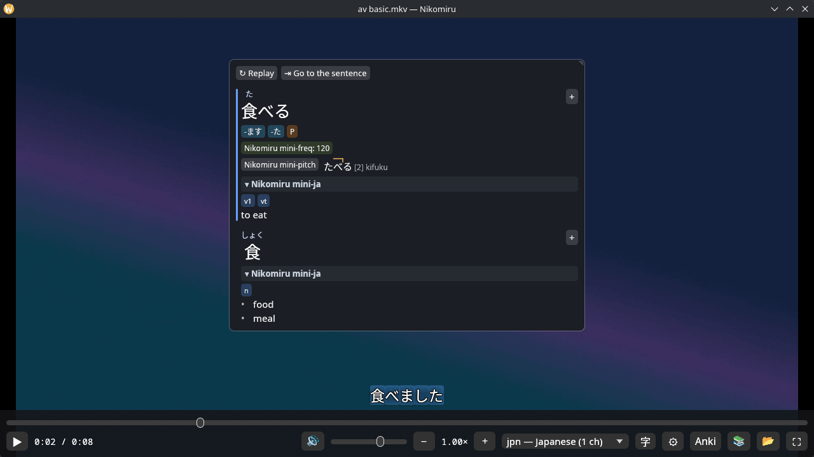
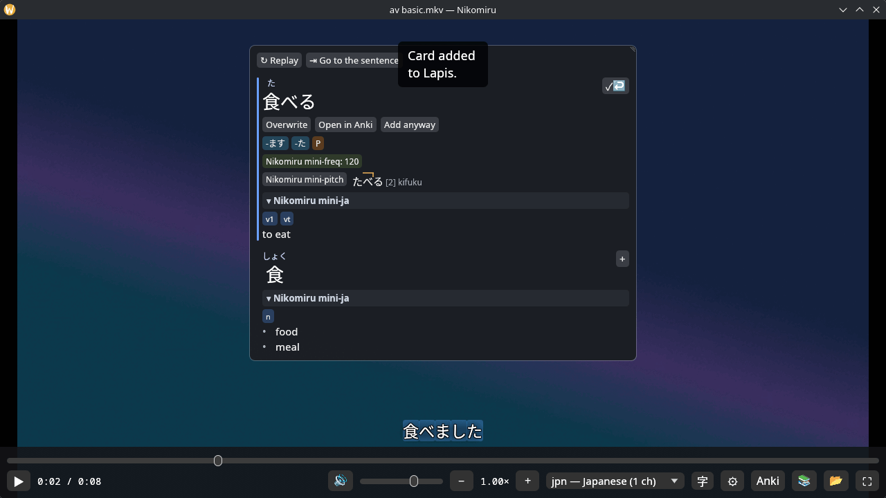
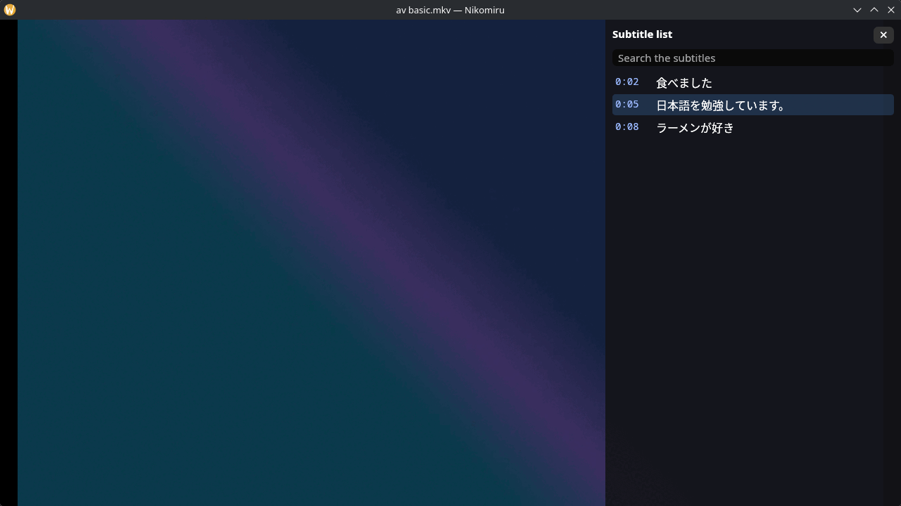
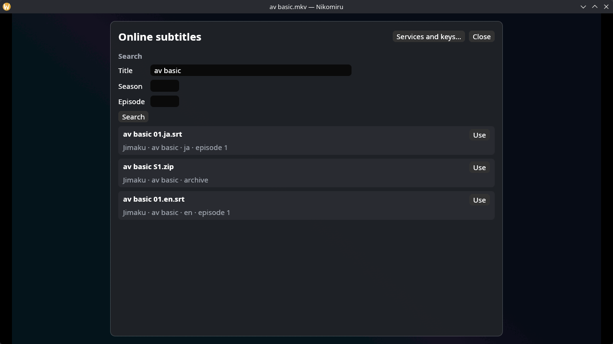
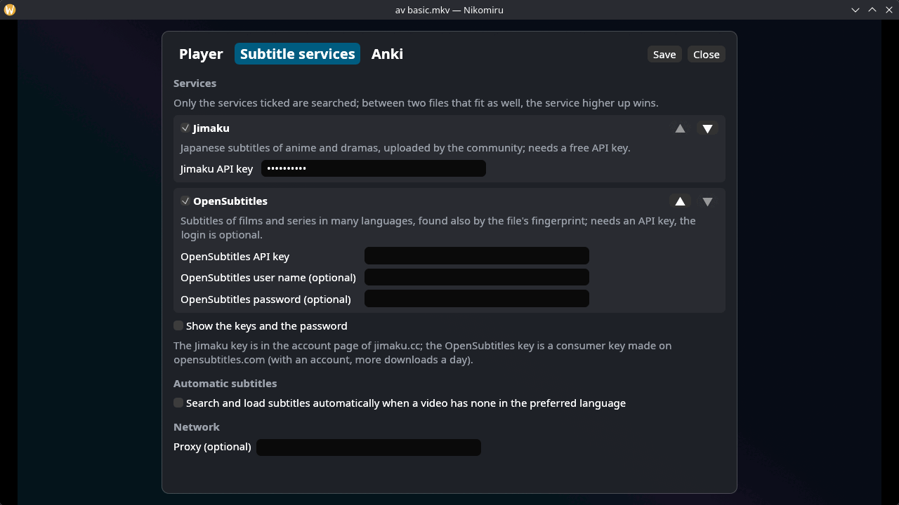
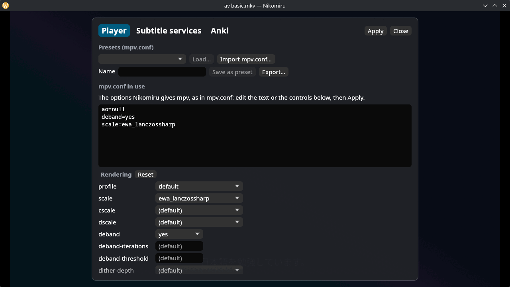
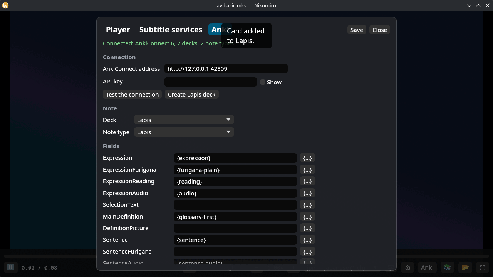

<p align="center">
  <picture>
    <source media="(prefers-color-scheme: dark)" srcset="assets/brand/logo-dark.svg">
    
  </picture>
</p>

<h1 align="center">Nikomiru</h1>

<p align="center"><b>A video player for learning Japanese from the anime and series you watch.</b></p>

<p align="center">
  Click a word in the subtitles, read it in your Yomitan dictionaries with pitch accent and frequencies,
  and make an Anki card with the sentence, the frame and the audio of the line in one click.
  Written in Rust, with mpv for playback.
</p>

<p align="center">
  
  
  
  
</p>

<p align="center">
  
  <br>
  <sub>A click on 食べ in 食べました: the popup finds 食べる through the conjugation, with its frequency, pitch accent and meaning. Project-made video and test dictionaries.</sub>
</p>

<p align="center">
  <a href="#screenshots">Screenshots</a> ·
  <a href="#why-nikomiru">Why Nikomiru</a> ·
  <a href="#what-works-today">What works today</a> ·
  <a href="#quick-start">Quick start</a> ·
  <a href="#architecture">Architecture</a> ·
  <a href="#roadmap">Roadmap</a> ·
  <a href="#downloads">Downloads</a> ·
  <a href="#license-and-credits">License and credits</a>
</p>

## Screenshots

<table>
  <tr>
    <td width="50%"><br><sub>The card is in Anki: overwrite it, open it in Anki or add another.</sub></td>
    <td width="50%"><br><sub>The subtitle list: search, jump to a line, click its words too.</sub></td>
  </tr>
  <tr>
    <td width="50%"><br><sub>Subtitles found online, the Japanese ones of the episode first.</sub></td>
    <td width="50%"><br><sub>Settings: the subtitle services to use, in your order.</sub></td>
  </tr>
  <tr>
    <td width="50%"><br><sub>Settings: the mpv options as <code>mpv.conf</code> text and as controls.</sub></td>
    <td width="50%"><br><sub>Settings: the Anki deck, note type and fields (Lapis ready).</sub></td>
  </tr>
</table>

## Why Nikomiru

- **Every word is clickable.** Nikomiru draws the subtitles itself (SRT, ASS, WebVTT, embedded tracks), so any character can be looked up; mpv draws only the video.
- **Your Yomitan dictionaries.** Import the same ZIP files as Yomitan: terms, kanji, frequencies and pitch accent, with conjugations undone as Yomitan does.
- **One-click Anki cards.** A Lapis card with the word in the sentence, the frame, the audio of the line and a link that reopens the scene; Ctrl+Enter from the keyboard.
- **Subtitles that fit.** Files next to the video are found also by episode; the missing ones come from Jimaku or OpenSubtitles, by hand or by themselves; an offset is found from the audio; a second subtitle (a translation) can sit above the first.
- **mpv as you like it.** Your `mpv.conf` loads with a preview of every line, presets switch in one click, and the options apply without reloading the file.
- **Private by default.** Nothing goes online unless you ask; keys stay in a file only you can read, never in the logs.

## What works today

Version 0.2.0 is an alpha for Linux. The status of each area follows the [ROADMAP](docs/ROADMAP.md).

| Area | Status |
|---|---|
| Player: open, play, seek, speed, tracks, chapters, fullscreen, resume, screenshots | Works; the manual checklist on Wayland and X11 is still open (M1) |
| Subtitles: SRT, ASS, WebVTT, embedded tracks, encodings, list, blur, offset | Works (M2) |
| Dictionaries: Yomitan import, lookup with deinflection, popup with pitch accent and frequencies | Works with the project's test dictionaries; the comparison with Fushi on real dictionaries is still open (M3) |
| Mining to Anki: Lapis cards with sentence audio, frame and a link back to the scene | Works against a simulated AnkiConnect; not yet checked with a real Anki and AnkiDroid (M4) |
| Online subtitles: Jimaku and OpenSubtitles, by hand or automatic; alignment with the audio; secondary subtitle | Works against simulated services; not yet checked with real keys (M4b) |
| mpv options: controls, `mpv.conf` presets, import and export | Works (M4b) |
| Library, word audio (also from a local `android.db`) | Works with project-made files; a real library of hundreds of episodes is still to be checked by hand (M5) |
| Statistics, the full settings, more languages | Planned for 0.3 (M6) |
| Online metadata (AniList, Jikan) | Planned for 0.4 (M7) |
| Packages (AUR, Flatpak) | Planned for 1.0 (M8) |

## Quick start

You need Rust through `rustup` (the version is pinned in `rust-toolchain.toml`) and these system libraries: libmpv ≥ 0.37, FFmpeg ≥ 6, OpenGL with EGL (Mesa or NVIDIA's driver), the Wayland or X11 client libraries and libxkbcommon, fontconfig, OpenSSL 3 and a font with Japanese glyphs (for example Noto Sans CJK). Building also needs the development files of libmpv and OpenSSL, and `pkg-config`.

```sh
git clone https://github.com/KvasFan/nikomiru.git
cd nikomiru
cargo xtask install            # release build into ~/.local/bin, with the desktop entry
nikomiru path/to/episode.mkv
```

`cargo xtask install` also registers Nikomiru for `nikomiru://` links, so the link in a card opens its scene. To try it without installing: `cargo run --release -p nikomiru-app -- path/to/episode.mkv`.

Then:

1. **Dictionaries**: 📚 in the bar → import your Yomitan dictionaries (JMdict, a frequency and a pitch accent dictionary). Nikomiru ships none.
2. **Anki**: install the [AnkiConnect](https://ankiweb.net/shared/info/2055492159) add-on in Anki and keep Anki open. In Nikomiru, ⚙ → Anki → "Create Lapis deck", or choose your own deck and note type.
3. **Online subtitles** (optional): ⚙ → Subtitle services → tick the services, paste a free [Jimaku](https://jimaku.cc) key and/or an [OpenSubtitles](https://www.opensubtitles.com) consumer key.

Logs are in `~/.local/state/nikomiru/logs/`.

## Architecture

A Cargo workspace of 11 crates: pure logic (`nikomiru-core`, `-text`, `-dict`, `-subs`, `-anki`, `-library`, `-online`), the programs it drives (`nikomiru-media` for ffmpeg, `nikomiru-player` for libmpv), the egui interface (`nikomiru-ui`) and the binary (`nikomiru-app`). mpv draws the video with its OpenGL render API into the window under the interface; workers on their own threads talk to Anki, the online services and ffmpeg, so the interface never waits. See [SPECIFICATION §5](docs/SPECIFICATION.md#5-architecture) and the [architecture decisions](docs/adr/).

| Document | Contents |
|---|---|
| [docs/SPECIFICATION.md](docs/SPECIFICATION.md) | Purpose, licenses, architecture, requirements, decisions and risks |
| [docs/ROADMAP.md](docs/ROADMAP.md) | Milestones M0–M8 up to 1.0, exit criteria, post-1.0 backlog |
| [docs/TEST.md](docs/TEST.md) | Test strategy, fixtures, conformance with Fushi, case catalog |
| [docs/adr/](docs/adr/) | Architecture decisions with the spike measurements |

### Development

```sh
cargo install --locked cargo-deny
cargo install --locked cargo-about --features cli
```

| Command | What it does |
|---|---|
| `cargo xtask ci` | fmt, clippy `-D warnings`, architecture checks, licenses (`cargo deny`), traceability, tests |
| `cargo xtask ci --full` | as above, plus fixtures, L4/L5 tests, the release build, the GUI end-to-end tests (L6, in an off-screen `kwin_wayland` on a private `dbus-daemon`; the accessibility test also needs at-spi2-core) and `THIRD_PARTY_LICENSES.html` |
| `cargo xtask fixtures [--large] [--perf]` | generates test media and dictionaries in `target/fixtures/` (requires `ffmpeg`) |
| `cargo xtask trace` | requirements ↔ tests ↔ milestones matrix in `target/trace.md` |
| `cargo xtask about` | generates `target/THIRD_PARTY_LICENSES.html` |
| `cargo xtask install [--prefix DIR]` | builds the release binary into `DIR/bin` (default `~/.local`) and installs the desktop entry |

The screenshots on this page come from the GUI harness: `NIKOMIRU_SCREENSHOTS=<folder> cargo test -p nikomiru-app --features test-harness --test e2e -- --include-ignored screenshots_of_the_interface`.

## Roadmap

0.1.0 brought mining to Anki (M4) and online subtitles with the mpv presets (M4b), 0.2.0 the library and word audio (M5). Next: statistics and the full settings (0.3), online metadata (0.4), then stabilization and packages for 1.0. Until 1.0 the focus is video with clickable subtitles; books, manga and online resources come after (D-12). Windows and macOS come after 1.0. The details are in the [ROADMAP](docs/ROADMAP.md).

## Downloads

| Format | Status |
|---|---|
| Source (`cargo xtask install`) | Available from 0.1.0 |
| PKGBUILD (AUR) | With 1.0 (D-5) |
| Flatpak (freedesktop runtime) | With 1.0 (D-5) |

## License and credits

[GPL-3.0-only](LICENSE). Nikomiru is a Rust rewrite of [Fushi](https://github.com/hajisensai/Fushi) and derives from GPL-3.0 code: Fushi, [Yomitan](https://github.com/yomidevs/yomitan) (deinflection tables), hoshidicts and the [Lapis](https://github.com/donkuri/lapis) note type, whose templates ship unchanged in `assets/anki/lapis/`. The logo and icons are original works of the project, under the same license.

The allowed dependencies are MIT, Apache-2.0, GPL and LGPL, with a few permissive exceptions documented in [SPECIFICATION §3](docs/SPECIFICATION.md#3-licenses) and checked by `cargo deny`; `cargo xtask about` lists them all in `THIRD_PARTY_LICENSES.html`.

Nikomiru was called Anikoto until 2026-10-19 (decision D-11).
